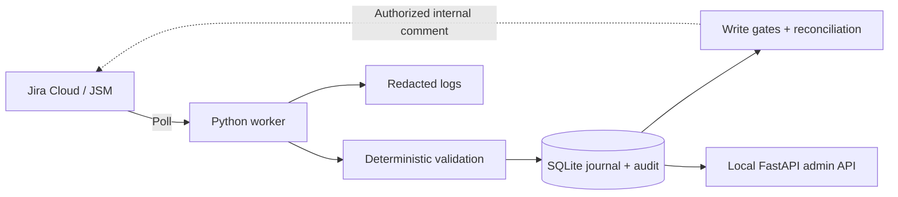

# AccessFlow

[](https://github.com/Eklavya20/accessflow-jira/actions/workflows/offline-checks.yml)

**Access-request triage for Jira Service Management, with human authorization preserved.**

IT support teams must check the application, access level and business justification in each request before deciding what happens next. AccessFlow automates that preparation: it discovers requests, validates their content and records a clear next action for a human. It does not grant access.

## How it works



Requests are classified as ready for human fulfillment, missing information, privileged review or manual triage. SQLite retains revisions, action intentions, comment IDs and retry state across restarts. Uncertain writes are reconciled rather than blindly resent.

**Dry-run is the default.** Triage write-back adds internal comments only, under exact-comment approval or a separately approved bounded worker policy. Status, assignment, approval decisions and application permissions are outside the implemented write scope. The operational pipeline uses no LLM. A separate [synthetic Groq extraction prototype](docs/GROQ_EVALUATION.md) is disabled, has no worker hook and awaits review.

## Evidence and limits

- **252 offline tests pass** on this feature branch: the original 186 plus 66 prototype checks, alongside lint, formatting and dependency checks.
- Real Jira sandbox tests verified discovery, classification, authorized internal comments, API read-back, duplicate prevention and restart persistence.
- Native Windows startup, shutdown and recovery instructions were exercised. Docker/Compose is provided but remains **unverified**.

This is a verified sandbox implementation, not a production-readiness claim. Production load, host reboot supervision and live outage/restore drills remain untested. No time savings, adoption or ROI have been measured. See [results](docs/RESULTS.md) and the [verification report](docs/FINAL_VERIFICATION.md).

## Install and verify

Tested on Windows with Python 3.11. From PowerShell:

```powershell
git clone https://github.com/Eklavya20/accessflow-jira.git
cd accessflow-jira
python -m venv .venv
.\.venv\Scripts\python.exe -m pip install -r requirements-dev.lock.txt
.\.venv\Scripts\python.exe -m pip install -e . --no-deps
.\.venv\Scripts\python.exe scripts/check.py
if (-not (Test-Path .env)) { Copy-Item .env.example .env }
```

The offline checks require no Jira account. If needed, use `py -3.11` instead of `python` to create the environment. CI runs the same checks on Windows/Python 3.11; it receives no Jira credentials.

## Connect your own sandbox

Follow [Jira setup](docs/JIRA_SETUP.md) to configure authentication in your private environment or ignored `.env`, discover your project/desk/request-type IDs, and select a synthetic test request. Keep dry-run enabled and worker writes disabled.

```powershell
.\.venv\Scripts\python.exe -m accessflow discover
# After configuring the target identifiers; replace TEST-1 with your issue key:
.\.venv\Scripts\python.exe -m accessflow check
.\.venv\Scripts\python.exe -m accessflow process TEST-1 --dry-run
.\.venv\Scripts\python.exe -m accessflow show TEST-1
```

Dry-run reads Jira and persists local results; it sends no Jira writes. Credentials, databases, logs and backups are excluded from Git. The public write policy is an unapproved, expired example; historical approvals do not authorize a new deployment.

After configuring eligible request types and a private admin token, the native worker can run independently:

```powershell
.\.venv\Scripts\python.exe scripts/manage_service.py start
.\.venv\Scripts\python.exe scripts/manage_service.py health
.\.venv\Scripts\python.exe scripts/manage_service.py stop
```

The API binds to loopback by default. The host must stay available; the launcher does not install a Windows service or reboot autostart. See the [runbook](docs/RUNBOOK.md) for logs, backups, recovery and explicitly authorized write procedures.

## Explore

[Architecture](docs/ARCHITECTURE.md) ? [Business analysis](docs/BUSINESS_ANALYSIS.md) ? [Two-minute demo](docs/DEMO_SCRIPT.md) ? [Design Q&A](docs/INTERVIEW_QA.md) ? [Publication checks](docs/PUBLICATION.md)

Licensed under [MIT](LICENSE).
