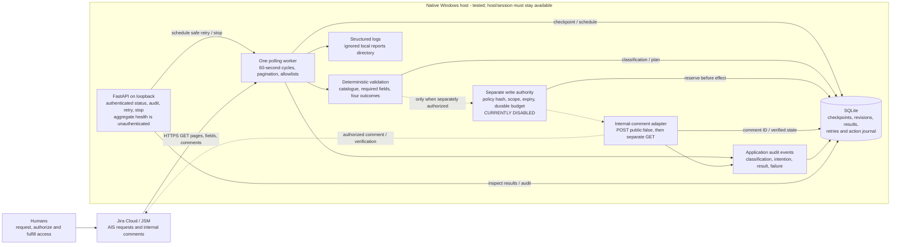

# Architecture

Status: deterministic triage, durable results/audit, per-issue locking, polling, persistent retry scheduling and authenticated FastAPI administration are implemented. AIS-4 passed autonomous dry-run acceptance; AIS-5 passed separately approved automatic internal write/read-back plus later-poll and actual worker-restart checks. Milestone 3 passes with the native Windows fallback. Its one-action approval is consumed and every unattended-write gate is disabled; the healthy worker continues dry-run polling. Docker/Compose is prepared but runtime-untested here. See [actual evidence](RESULTS.md).

Solid arrows show current ingestion, classification, persistence and inspection. Dashed arrows show the implemented write capability, exercised only under the consumed AIS-5 approval and disabled now. Audit history is stored in SQLite; log files are a separate operational stream. No path provisions application permissions or decides a human approval. Docker/Compose is a supplied, unverified deployment alternative, not another running component.

## Component boundaries

Implemented modules:

- `config.py`: Pydantic settings, secret handling, Cloud URL restriction, project allowlist, designated test target.
- `jira.py`: httpx transport, identity/project/desk validation, effective permissions, paginated reads, bounded GET retries, guarded probe POST.
- `discovery.py`: metadata report and account capability observations without request text/user profiles.
- `probe.py`: durable SQLite reservation, stable operation marker, comment write/read-back, uncertainty reconciliation.
- `cli.py`: explicit commands, structured JSON reports/events, redacted errors and exit codes.
- `domain.py`: typed policy, request, decision, and processing result models.
- `parsing.py`: ADF/plain-text extraction, explicit field validation, catalogue matching, and deterministic four-outcome classification.
- `ingestion.py`: live JSM scope validation, request type and description reads, and eligible requester corrections.
- `processor.py`: revision-aware action planning, exact-hash write authorization, internal comments, read-back, and uncertainty reconciliation.
- `persistence.py`: SQLite processing/results/operations/audit and OS-owned per-issue locks.
- `worker.py`: scoped paginated discovery, update/source checkpoints, periodic source rescans, single-worker loop, retries and graceful-stop signaling.
- `worker_store.py`: additive versioned worker schema, runtime heartbeat, jobs and durable write-budget reservations.
- `worker_policy.py`: separately approved policy hash, bounded ticket/type/outcome/summary scope, expiry and comment-only action limits.
- `service.py`: local FastAPI health/admin routes and one worker thread in the application lifespan; a worker failure requests service exit.

`config/policy.json` supplies the initial application catalogue, access aliases, privileged levels, optional text field mappings, and human team instructions. `classify` consumes typed domain input independently of Jira/SQLite. The separate worker write policy was explicitly approved for one AIS-5 action, now consumed and disabled. Its exact disabled bytes are retained privately; `config/worker-write-policy.json` is a disabled, expired public example and local `.env` selects the private copy with `ACCESSFLOW_WRITE_POLICY_PATH`. Its exact activation hash and durable budget remain in the evidence/journal. Future unattended actions require separately approved scope; richer Jira routing remains outside authorization.

## Automatic discovery and scheduling

Each cycle enumerates every page of `GET /rest/servicedeskapi/request`, separately filtered by configured service-desk and request-type IDs. It rejects unexpected projects/desks/types, deduplicates stable issue IDs and verifies actual Platform project ID/key before ingestion. This uses the existing JSM read capability; no search-scope expansion or webhooks were needed. The collection covers requests visible to the configured identity, not an assertion of organization-wide visibility. See [Atlassian's request-list reference](https://developer.atlassian.com/cloud/jira/service-desk/rest/api-group-request/#api-rest-servicedeskapi-request-get).

The default interval is 60 seconds after a completed cycle (minimum 30 seconds). A light `updated,project` read per visible request allows unchanged jobs to skip expensive ingestion. Every 300 seconds by default, full source/comment ingestion runs even when Jira's timestamp is unchanged, because comment activity is not assumed to advance that field. Relevant requester corrections, fields and policy are fingerprinted; status-only changes and internal/self-generated comments are excluded. Unchanged source skips classification/audit duplication. Write-mode/policy changes invalidate checkpoints for safe reevaluation. This full enumeration is intentionally appropriate for the small sandbox; larger installations need volume measurements and an indexed incremental-discovery strategy before rollout.

`worker_jobs` stores stable IDs/keys, Jira update timestamp, source fingerprint, processing/check times, outcome, state, retry time, attempts, errors and operation/comment IDs. `worker_runtime` stores heartbeat, run ID, last poll success/error and next poll time. The next-poll deadline and retry deadlines survive process restart, preventing early retry after a rate limit. Running jobs are reevaluated after restart. A single OS-owned worker lock prevents overlap on the same local database; existing per-issue locks still coordinate with the CLI. Different databases/hosts are not coordinated.

## Data flow and authorization

The CLI explicitly targets one allowlisted JSM issue. Ingestion verifies actual project ID/key and service desk, retrieves its request type and Platform description, and reads all comment pages. Input uses English `Application:`, `Access level:`, and `Business justification:` lines or explicitly mapped text/ADF fields. A single known application in simple prose can be recognized; access level and justification are never guessed from prose. Unknown, conflicting, unsupported or excessively long values require human triage.

Only formatted public comments authored by the actual requester can correct prior field values. Internal comments, other participants, and AccessFlow-generated comments do not become requester corrections. Requester identity is used transiently; the saved result exposes availability rather than profiles/email. Request text cannot change policy, project scope, write authorization, or approval decisions.

Policy checks application catalog, allowed permission levels, justification, and privileged access classification. Complete requests route to humans; incomplete requests receive one missing-information comment; unknown applications or privileged requests require review. Jira comments containing approval language are never authorization. Native approval records may be observed when configured; the application will not answer approvals or provision permissions.

Jira authentication uses account email/API token. Secret values stay in local settings and HTTP authorization headers. HTTPS verification remains enabled, redirects disabled, and API hosts constructed from validated configuration. FastAPI uses a separate random Bearer token with constant-time comparison for all issue/status/audit/retry/shutdown routes. Only aggregate `/health` is unauthenticated. Native binding defaults to 127.0.0.1; Compose exposes only host loopback. Local HTTP is intended for that boundary; remote administration needs reviewed TLS/network controls. Secrets are runtime configuration, excluded from the Docker build context and API output.

## Persistence and remote side effects

The current journal uses SQLite's standard library driver, an adequate small persistence layer for one probe operation. A unique operation key combines site, stable issue ID, and probe version. A persisted body hash binds the exact approved text; changed text or visibility cannot trigger another post. The reservation commits before the POST. Concurrent callers can reserve only once. Each run verifies the exact remote body, author, and visibility, and can reconcile a previously uncertain result. A pending operation without a visible comment is blocked from resending, including a crash before sending. This favors safety and may require operator intervention.

SQLite and Jira cannot share an atomic transaction. No exactly-once guarantee is claimed. The current guard is limited to the connectivity comment on a single host with the same journal; this is not a general distributed worker lock. Keep journal and Jira evidence together and never reset state to force retries.

The processor uses separate `triage_*` tables alongside the preserved connectivity journal. An OS-owned lock covers the stable site/issue ID for the full processing operation. It is released on process exit; no timed lease can expire while a remote write is still in flight. This supports one host using the same local database and lock directory, not multiple independent deployments or network filesystems.

Semantic changes to the decision or policy increment a durable issue revision. That revision and semantic hash determine the operation marker. Repeated unchanged input reuses the same marker; changing A to B and back to A produces a new revision, so Jira receives a current summary rather than silently relying on an old comment. Status-only changes and the processor's own comments do not create new revisions.

Write authorization requires the SHA-256 of the current exact comment, checked under the issue lock. A fresh read immediately before the POST rejects changed decision input. The pending intent and authenticated author commit before the remote side effect. A stored comment ID is read back; otherwise a paginated marker scan reconciles crash uncertainty. Older unresolved operations must reconcile before a new revision can write. Local SQLite and Jira still cannot commit atomically; a final read cannot prevent every later external edit, and no exactly-once guarantee is claimed.

Audit events append through the application for classification, authorization, post intent, success, reconciliation and failure. They are operational history, not a tamper-proof compliance ledger. Results and proposed comment bodies contain request details and remain in ignored local state.

## Failure handling

Current GET calls retry 429 and 5xx or transport failures up to the configured attempt bound. Backoff includes jitter; `Retry-After` supports seconds and HTTP dates. A wait exceeding the local budget exits for later retry without retrying early. 401/403 do not retry. POST transport/429/5xx responses leave the journal pending; a later command reconciles without automatically resending. Writes never fall back from internal to public comments.

GET retry/backoff remains in the existing client. New POSTs are sent once. A definitive 400/401/403 rejection becomes blocked and needs an explicit approved retry after repair. Transport/5xx/uncertain verification outcomes remain pending/uncertain and reconcile without blind resend. Worker jobs schedule exponential delays from at least 60 seconds up to a 3600-second backoff cap, extending beyond that cap when Retry-After requires it; five attempts is the default per-job bound. Authentication/configuration failures become operator-visible terminal jobs. Discovery failures use a persistent next-poll deadline and capped backoff without pretending the missing scan succeeded. Live outage/crash fault injection remains unperformed; recovery behavior is covered offline.

Unattended writes require three independent settings (enabled, global dry-run false, exact approved policy hash), approved unexpired policy bytes and matching request scope. The action budget is reserved durably before the attempt; policy scope is checked again against refreshed input immediately before a new POST. One logical action per permitted issue and at most one action per poll are enforced. Out-of-policy requests remain classifications without writes. Uncertain effects keep their existing reservation and reconcile; neither retry nor database restart resets the budget. Missing uncertain comments never trigger blind resend.

## Why deterministic automation first

The required fields and routing policies are small and auditable. Deterministic validation provides a reliable baseline without an external model, data disclosure, cost, or model availability dependency. Optional extraction can be evaluated after live success; it will never own authorization.

## Native Jira Automation versus custom Python

Native rules may reduce operational burden for simple field/status actions when available within plan limits. Custom Python makes testable business rules, reconciliation, audit persistence, API error handling, and portability explicit, but requires hosting and maintenance. Choose the custom worker for this portfolio's engineering/reliability goals while using existing Jira workflows for human decisions. Confirm plan capabilities before relying on native automation; do not introduce public webhooks solely for the demonstration.
